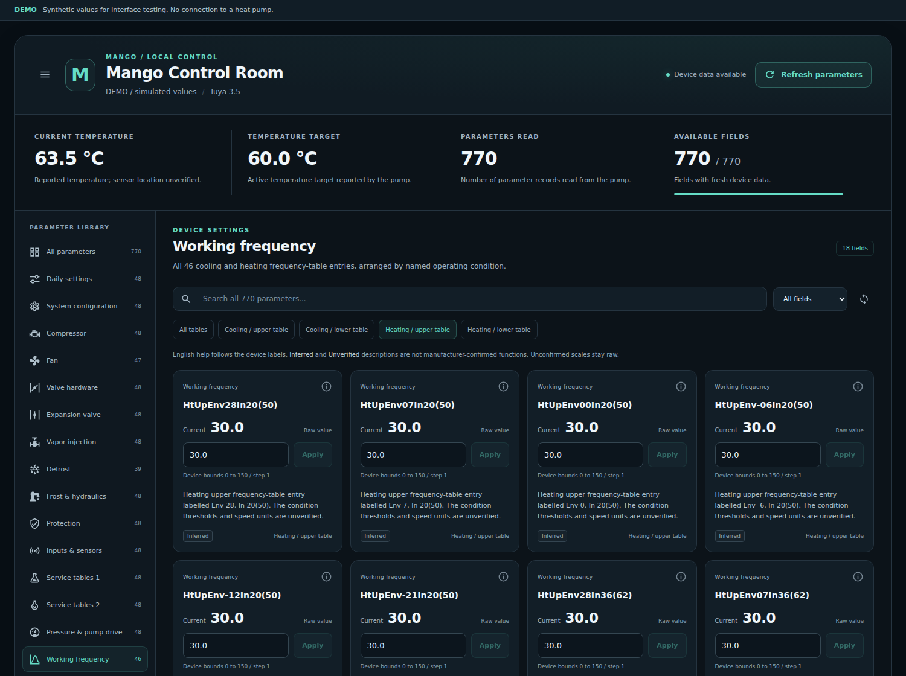
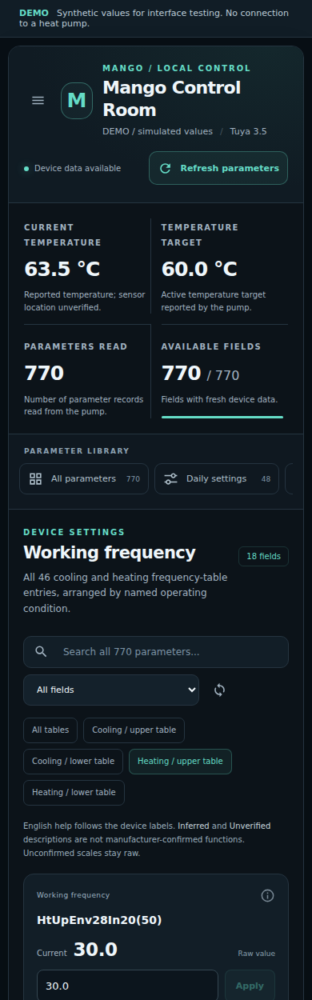

# Mango Control Room

The dashboard is installed with Mango Tuya Local **0.2.0**. After updating the
integration and restarting Home Assistant, open **Mango Control** in the sidebar.
Refresh your browser once so the new frontend module is loaded.

There are no additional HACS cards, external scripts, manually guessed entity
IDs or edits to Home Assistant's `.storage` files.



*Interface preview with synthetic demo values. This is not a capture from a
running heat pump.*

## What is included

- All **770 real parameter routes** in **17 categories**; no backup rows.
- All **46 WorkingFreq entries**, with four heating/cooling table filters.
- Current and target temperature, records read and live field availability.
- A short English explanation below every parameter and each sensor metric.
- Global search by name, category, explanation or group/slot key.
- Editable number fields, confirmed decimal scaling for Cool Ctrl Cpst, and
  the known Alarm Sound Set choices.
- A separate **Apply** action for each change. Typing, searching and opening
  the page do not send parameter writes.
- Inline readback/recovery results and a complete-refresh button.
- Mobile category navigation and desktop category navigation.
- Device selection when several Mango integrations are configured.

The card uses the **actual entity registry**. Renamed entity IDs are resolved
by the integration's unique identifiers. Refreshing the entity mapping does
not change the pump.

## English help and raw values

The device provides abbreviated labels, not a complete manufacturer manual.
Descriptions marked **Inferred** are interpretations of those labels.
Descriptions marked **Unverified** identify functions that remain unclear.
**Verified options** applies to the confirmed Sound On / Once 10sec choices;
the other sound codes remain raw.

This help does not establish individual hardware write permissions. Unconfirmed
units and scales remain raw. Device bounds and readback checks are enforced by
the existing local client; a fixed device range is shown as fixed bounds.
An unavailable field cannot be edited. Existing Home Assistant read/control
permissions are respected.

The full English help catalogue is in [PARAMETERS.md](PARAMETERS.md).

## Add it to an existing dashboard

The frontend module is registered automatically by the integration. Add this
card in the dashboard's YAML editor:

```yaml
type: custom:mango-parameter-card
title: Mango Control Room
default_group: 14
```

To create a dedicated Lovelace dashboard, use
[mango_control_room.yaml](../dashboards/mango_control_room.yaml).
The automatic sidebar panel already contains the same controls.

`default_group` accepts 0-16. `entry_id` is optional; omit it for automatic
initial selection and the built-in pump selector. A configured missing entry
never silently switches to another pump.

## Mobile

Swipe the category strip horizontally, then scroll through the selected
category. Each original category contains at most 48 fields.



*Synthetic demo values; the live dashboard uses your Home Assistant states.*

## Development preview

`tests/frontend/demo.html` is an interactive synthetic fixture for this exact
custom element. It has no connection to a pump. The tests and preview use
Material Design Icons; the icon licence is in [licenses/mdi-license.txt](licenses/mdi-license.txt).

```bash
npm ci
npm test
```

The optional `tests/frontend/browser-check.cjs` uses Playwright. Install it
separately for that check; `MANGO_CHROMIUM_EXECUTABLE` can point to a locally
installed Chromium. It checks desktop/mobile layouts, explicit writes,
refused writes, search, refresh and the rendered descriptions.
